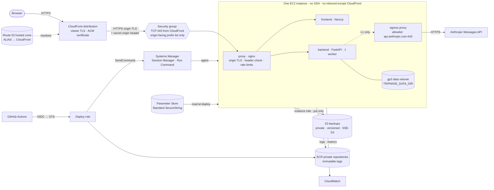

# AWS deployment plan (planned — not provisioned)

**Status:** PLANNED. No AWS account, resource, credential, domain, DNS record, certificate, or
Anthropic API key exists for this plan. Nothing in this document has been executed against AWS or
Anthropic. It is not a production-readiness claim, and none of its phases has started.

**Research date for every time-sensitive claim:** 2026-10-22. **Region assumption:** US East
(N. Virginia), `us-east-1`. Re-verify every price and policy immediately before provisioning, and
price the final design in the AWS Pricing Calculator.

This is the canonical architecture and Claude runtime design. The canonical cost and capacity
figures are in [AWS_COST_AND_CAPACITY.md](AWS_COST_AND_CAPACITY.md); the planned procedures are in
[AWS_OPERATIONS_RUNBOOK.md](AWS_OPERATIONS_RUNBOOK.md). The verified local stack is described in
[DEPLOYMENT.md](DEPLOYMENT.md) and [the D1 report](../reports/d1_deployment_foundation.md).

---

## 1. Executive recommendation

Run the existing D1 Docker Compose stack, unchanged in shape, on **one Amazon Elastic Compute
Cloud (EC2) instance** in a new, standalone AWS account, behind **Amazon CloudFront**. Keep SQLite
on a separate encrypted Amazon Elastic Block Store (EBS) volume, back it up to a private Amazon
Simple Storage Service (S3) bucket, deliver immutable images from Amazon Elastic Container Registry
(ECR) through GitHub Actions using OpenID Connect (OIDC), and administer the host only through AWS
Systems Manager (SSM). Integrate Claude through the native Anthropic Messages API with a persistent
usage ledger and hard runtime limits, and launch to invited users only.

**The first decision is not technical, and it belongs to the human.** The research found that the
two goals in the brief — redeem the ~$125 AWS promotional credit, and keep the project's
USD 0 out-of-pocket rule — cannot both be met by account structure alone:

- AWS states: "Free account plans are not eligible for other promotional credits and discounts."
  Redeeming the promotional credit therefore requires the **Paid account plan**, where "you are
  charged the standard pay-as-you go pricing for any usage beyond your Free Tier credit balance, or
  if you use AWS services where credits don't apply"
  ([Choosing a plan](https://docs.aws.amazon.com/awsaccountbilling/latest/aboutv2/free-tier-plans.html)).
- `DEVIATIONS.md` (2026-08-02) allows credits only "when overage is mechanically impossible," and
  the project's agent rules require human approval for anything needing paid services.

The plan therefore defines two account profiles with the same architecture (section 4):

| Profile | Account plan | AWS credit | Overage | Status |
|---|---|---|---|---|
| **P — recommended** | Paid | ~$125 promotional + $100 sign-up (+ up to $100 from activities) | Possible; bounded by controls, not prevented | **Requires an explicit human approval** recorded in `DEVIATIONS.md` before D2 |
| **F — compliant fallback** | Free | $100 sign-up (+ up to $100 from activities); promotional credit unusable | Not possible; account closes at 6 months or when credits run out | Usable without an exception |

Profile P is recommended because it is the only way to use the credit the brief was written
around, it does not close at six months, and it can use every service in this plan. It is not
recommended unless the human accepts its residual risk in writing.

Three further findings change the brief:

1. **`t4g.medium` is not a Free Tier eligible type.** For accounts created on or after 2025-07-15,
   AWS lists `t3.micro`, `t3.small`, `t4g.micro`, `t4g.small`, `c7i-flex.large` and
   `m7i-flex.large` as eligible
   ([EC2 Free Tier usage](https://docs.aws.amazon.com/AWSEC2/latest/UserGuide/ec2-free-tier-usage.html)).
   On Profile F it cannot be launched at all; on Profile P it can, at double the `t4g.small` rate.
   The design target is therefore **2 GiB of memory**, and measuring that is the first D2 gate
   (section 9).
2. **The CloudFront flat-rate Free plan is probably unavailable.** AWS lists "Your account is using
   AWS Free Tier" as an account-level reason a plan cannot be subscribed, and states that
   flat-rate plans "cannot be combined with any other offers, promotions, or discounts"
   ([flat-rate plans](https://docs.aws.amazon.com/AmazonCloudFront/latest/DeveloperGuide/flat-rate-pricing-plan.html)).
   Both conditions likely apply to a new account holding credits. This plan therefore budgets for
   **pay-as-you-go CloudFront** within its always-free allowance and treats the flat-rate plan as
   an option to test in the console at D5, not as an assumption.
3. **The current LLM client cannot be repointed at Anthropic.** `backend/agents/llm.py`
   (`HostedFreeTier`) sends OpenAI-shaped `chat/completions` requests with
   `response_format: {"type": "json_object"}` and `temperature` 0.0 or 0.3
   (`backend/agents/config.yaml`). Anthropic's OpenAI compatibility layer ignores
   `response_format` and `strict`, does not support prompt caching, and on Claude 4.7 and later
   models returns a 400 for a `temperature` below 1
   ([OpenAI SDK compatibility](https://platform.claude.com/docs/en/cli-sdks-libraries/libraries/openai-sdk)).
   A native client is required (section 22).

## 2. D1 starting point (verified locally, not on AWS)

From the [D1 report](../reports/d1_deployment_foundation.md) and [DEPLOYMENT.md](DEPLOYMENT.md):

- `deploy/compose.yaml` defines `proxy` (nginx-unprivileged, the only published port, bound to
  `127.0.0.1`), `backend` (FastAPI, `uvicorn --workers 1`), and `frontend` (Next.js standalone).
  Backend and frontend are on a network with `internal: true`, so **neither has outbound network
  access**. The proxy spans `edge` and `internal`.
- All containers are read-only, drop all capabilities, use `no-new-privileges`, and run non-root.
- State lives under `TRIPWISE_DATA_DIR` (`/data`). `accounts.sqlite` is the only irreplaceable
  database; the knowledge base is rebuilt from seeds on every start.
- Planning jobs live in one process's memory and are lost on restart (the smoke test observes a 404
  after restart). Confirmation and preference locks are process-local.
- `scripts/d1-backup.sh` takes an integrity-checked SQLite online backup and verifies its SHA-256.
  No scheduled or off-site backup exists.
- `/health/live` and `/health/ready` exist; readiness reports sample mode with no live provider.
- Measured image sizes: backend 656 MB, frontend 433 MB (uncompressed).
- Every live-capable provider switch is refused at startup when `TRIPWISE_ENV=production`.
- **Not present:** sign-in UI; authentication or rate limiting on the legacy `/plan` and
  `/places/search` endpoints; a Content Security Policy (CSP); trace retention (each `/plan` request
  writes a trace file to `/data/traces`, on the accounts volume); log aggregation; metrics;
  alerting; any persistent LLM budget.
- The LLM call ceiling (`TRIPWISE_LLM_MAX_CALLS`, default 25) is **per request**: `api/main.py`
  constructs a new `HostedFreeTier()` per request. No daily, global, or durable budget exists.

## 3. Goals and non-goals

**Goals**

- Keep an invitation-only portfolio deployment online for as much of the credit period as the
  credits allow, with the shutdown date planned rather than discovered.
- Exercise AWS skills relevant to software and infrastructure roles: Infrastructure as Code (IaC),
  identity federation, least-privilege Identity and Access Management (IAM), immutable image
  delivery, edge delivery and Transport Layer Security (TLS), backup and restore, and recorded
  operational drills.
- Make every failure recoverable within a documented time: restore, rollback, reboot, kill switch.
- Bound Claude spend structurally (prepaid credits, no auto-reload) and AWS spend as tightly as the
  chosen account profile allows.
- Produce operating evidence — drill timings, dashboards, measured cost per plan — for interviews.
- Improve agent quality with typed outputs, a replay corpus, and batch evaluation, not more autonomy.

**Non-goals**

- High availability, horizontal scaling, zero-downtime deployment, autoscaling, or any measured
  user capacity. The application supports exactly one backend replica (section 8).
- Commercial operation, a service-level agreement, or licensed production travel data.
- Activating Gondola, Tripadvisor, Open-Meteo, or any other provider or MCP server.
- Bookings, payments, points transfers, bank linking, or statement import.
- Using an AWS service only to list it.

## 4. Spend controls and account profiles

### 4.1 What each mechanism can and cannot do

| Mechanism | What it guarantees | What it does not |
|---|---|---|
| AWS **Free account plan** (Profile F) | No charges; "Account closes when credits are depleted or when the plan duration ends" ([Choosing a plan](https://docs.aws.amazon.com/awsaccountbilling/latest/aboutv2/free-tier-plans.html)). | Cannot redeem promotional credits; closes after six months; AWS retains content 90 days, then deletes it. |
| AWS **Paid account plan** (Profile P) | Promotional credits apply; "Account doesn't close when credits are depleted" (same source). | Charges the payment method for usage beyond credits, or for services credits do not cover. |
| **AWS Budgets** | Notifications, and budget actions that can stop EC2 instances or attach an IAM policy. | Not a cap: data "is updated up to three times a day" and you "might incur additional costs or usage that exceed your budget notification threshold before AWS Budgets can notify you" ([Budgets](https://docs.aws.amazon.com/cost-management/latest/userguide/budgets-managing-costs.html)). |
| Anthropic **prepaid credits, auto-reload off** | "If you run out of credits, you can no longer call the API or use the playground until you add more" ([billing](https://support.claude.com/en/articles/8977456-how-do-i-pay-for-my-claude-api-usage)). | Nothing additional is needed; the stop is structural. |
| GitHub Actions included minutes | Usage within included minutes; see the [cost model](AWS_COST_AND_CAPACITY.md#4-github-actions). | Charges only if a payment method and a non-zero budget are set. |

### 4.2 Profile P residual risk and its controls

Profile P's exposure is the gap between usage and AWS noticing it. The controls below shrink that
gap and the blast radius; they do not close it.

1. **Fixed footprint.** Every hourly charge comes from resources Terraform declares; the monthly
   total is predictable to within a few dollars ([cost model § 2](AWS_COST_AND_CAPACITY.md#2-aws-monthly-scenarios)).
2. **Guardrail policy on human and automation roles** denying the expensive mistakes: NAT gateways,
   load balancers, instance types other than the selected one, Regions other than `us-east-1`
   (global services excepted), RDS, ElastiCache, EKS, Savings Plans and Reserved Instances.
3. **Budgets:** a monthly cost budget on spend net of credits with an alert at $0.01 actual; a
   forecast alert on gross spend; credit-burn alerts at 50%, 75% and 90% of the planned credit
   allocation; and one **budget action that stops the EC2 instance** if net-of-credit spend exceeds
   $1. Verify the budget's credit-inclusion setting in the console when creating it.
4. **No long-lived access keys** anywhere. Human access uses one MFA-protected IAM administrator,
   not IAM Identity Center: Identity Center's organization instance creates an AWS Organization,
   which upgrades a Free plan account. Automation uses OIDC (section 14).
5. **Unbounded-usage vectors closed or capped:** the origin admits only CloudFront (section 18);
   CloudWatch log volume bounded by retention and log-level policy; S3 requests limited to the backup
   schedule; no public S3 access.
6. **Calendar:** the day-120/150/165 checkpoints and a fixed teardown date before credits run out
   ([cost model § 3](AWS_COST_AND_CAPACITY.md#3-credit-lifetime-and-checkpoints)).

The largest remaining risk is a compromised credential creating resources faster than Budgets can
report them. The approval request must state that risk plainly.

### 4.3 Consequences for both profiles

- **No AWS Organizations, Control Tower, Savings Plans, or Reserved Instances.** On Profile F the
  first two silently upgrade the account to Paid; on both, the last two commit beyond the credit
  period.
- **One account, one region.**
- **Domain registration outside AWS**, using the GitHub Student Developer Pack domain offer, with
  name servers delegated to a Route 53 hosted zone.

## 5. Architecture



| Component | Job | Phase |
|---|---|---|
| EC2 instance | Runs the D1 Compose stack | D2 |
| gp3 data volume | Holds `TRIPWISE_DATA_DIR`, separate from the root volume | D2 |
| Systems Manager | Shell access and deploy commands without SSH | D2–D3 |
| ECR | Immutable backend and frontend images | D3 |
| S3 backup bucket | Off-instance SQLite backups | D3 |
| Parameter Store | Runtime secrets | D3, L1 |
| CloudWatch | Logs, metrics, dashboard, alarms | D3 |
| Egress proxy | The backend's only outbound path, allowlisted to Anthropic | L1 |
| CloudFront, Route 53, ACM | Public edge, DNS, viewer certificate | D5 |
| Terraform | Declares everything above except secret values | D2 onward |

## 6. Flows

**Request (D5 onward).** Browser → Route 53 ALIAS record → CloudFront (viewer TLS with an AWS
Certificate Manager (ACM) certificate) → HTTPS to `origin.<your-domain>` on port 443 → the security
group admits only CloudFront origin-facing addresses → nginx checks the secret origin header,
terminates origin TLS, applies rate limits, and routes `/api/*` (prefix stripped) to the backend and
everything else to the frontend → the backend reads and writes SQLite on the data volume. D1's
same-origin cookie and CSRF design is unchanged.

**Deployment (D3 onward).** Merge to `main` → CI runs the existing gates and builds images for the
selected architecture → images are pushed to ECR tagged with the commit SHA and their digests are
recorded → a human manually dispatches the deploy workflow (section 14) → the workflow assumes the
deploy role through OIDC and calls SSM Run Command → on the host, the deploy script takes a
pre-deployment backup, pulls both images **by digest**, restarts the stack, waits for readiness, runs
the smoke checks, and restores the previous digests if any check fails.

**Backup (D3 onward).** A systemd timer runs the online-backup procedure (integrity check, SHA-256
verification) and uploads the file to S3 under an instance role that may only write objects under
one prefix. Daily EBS snapshots of the data volume give a second, crash-consistent recovery point.
Restore is drilled (section 23).

**Secrets (D3 / L1).** A human creates each secret as a Parameter Store Standard `SecureString`
parameter encrypted with the AWS managed key. The instance role may read only its own parameter
path. The deploy script writes them to a root-owned, mode-600 environment file that Compose reads.
They never enter an image, a Git commit, a GitHub secret, a log, or Terraform state (section 16).

## 7. Why one EC2 instance

1. **SQLite is the durable database** in default rollback-journal mode
   ([DEPLOYMENT.md § 11](DEPLOYMENT.md)). It needs exactly one writer process on local block storage.
2. **Planning jobs are process-local**; a second replica could not see the first one's jobs.
3. **Locks are process-local** (`api/conversation.py`).
4. **Budgets and call ceilings are per-process or per-file**, including the LLM ceiling.

An orchestrator, load balancer, or managed database would add cost and moving parts while still
being pinned to one replica. One instance running the Compose file D1 already verified keeps the
deployment an accurate representation of the application.

## 8. What this deployment does not claim

Until the database, job system, locks, and budgets are redesigned (section 25), this deployment does
not provide high availability, horizontal scalability, zero-downtime deploys, autoscaling, or
multi-region failover, and it has no measured user capacity. A deploy, reboot, or instance failure
takes the site offline for its duration and loses in-flight planning jobs; users re-run them.

## 9. Instance-selection gate

The instance type is chosen by measurement in D2. Prices are in the
[cost model](AWS_COST_AND_CAPACITY.md#2-aws-monthly-scenarios).

| Step | Rule |
|---|---|
| 1 | List the account's eligible types: `aws ec2 describe-instance-types --filters Name=free-tier-eligible,Values=true --query "InstanceTypes[*].InstanceType"`. On Profile F only these can be launched. |
| 2 | Build both images for the candidate architecture, run `make d1-smoke` and a scripted planning workload on the candidate instance, and record peak memory per container (`docker stats`), host memory, swap use, and CPU credit balance. |
| 3 | **Prefer `t4g.small`** (Graviton, 2 vCPU, 2 GiB) if, with a 1 GiB swap file as a guard, peak memory leaves at least 15% headroom and the swap-in rate stays near zero under the workload. |
| 4 | **Use `t3.small`** (x86, 2 vCPU, 2 GiB) instead if a tested native dependency fails on Arm. Do not force Graviton for a résumé keyword. |
| 5 | **If 2 GiB does not fit, stop and reduce memory first** (catalog overlay off, smaller buffers, fewer Next.js workers). On Profile P, `t4g.medium` (4 GiB) is the next option at about $12 more per month; on Profile F, the only eligible 4 GiB-class types (`c7i-flex.large`, `m7i-flex.large`) would consume the credit in under two months. Either change is re-planned with the human. |

- D1 built and smoke-tested the stack on an `arm64` host (`uname -m` = `arm64`). That is strong but
  indirect evidence for `linux/arm64`; D2 confirms it with an explicit `--platform linux/arm64` build.
- GitHub provides `ubuntu-24.04-arm` standard runners in private repositories against included
  minutes ([changelog](https://github.blog/changelog/2026-01-29-arm64-standard-runners-are-now-available-in-private-repositories/)),
  so Arm images build natively.
- `t4g.small` has a 20% per-vCPU baseline ([T4g](https://aws.amazon.com/ec2/instance-types/t4/)).
  Launch it in **standard** credit mode: unlimited mode bills surplus CPU credits.
- **No memory measurement exists yet.** Fitting in 2 GiB is the largest technical risk in this plan.

## 10. Docker Compose on EC2

The host runs Amazon Linux 2023 (confirm SSM Agent is present on the chosen AMI). D1's
`deploy/compose.yaml` is reused through a planned overlay, `deploy/compose.aws.yaml` (not written),
that changes only what the host requires:

| Concern | D1 local | Planned AWS overlay |
|---|---|---|
| Images | built from source | `<account-id>.dkr.ecr.us-east-1.amazonaws.com/tripwise-backend@sha256:<digest>` and the frontend equivalent |
| Proxy port | `127.0.0.1:8080` | 443 on the host, guarded by the security group |
| Origin TLS | none | nginx terminates TLS with the origin certificate (section 18) |
| Origin header | none | nginx returns 403 without the secret origin header |
| Data | named volume | the dedicated EBS volume mounted at `/srv/tripwise/data`, bind-mounted to `/data` |
| Secrets | optional `.env` | root-owned mode-600 file written by the deploy script |
| Egress | none | unchanged until L1, then the egress proxy only (section 19) |
| Boot | `unless-stopped` | unchanged; Docker and the stack start on boot through systemd |

All D1 hardening (read-only filesystems, dropped capabilities, `no-new-privileges`, pid and tmpfs
limits, non-root users, health-gated startup, one backend worker) stays.

## 11. Storage

- **Root volume:** gp3, 20 GiB, encrypted. OS, Docker images, 1 GiB swap file. Disposable.
- **Data volume:** gp3, 10 GiB, encrypted, mounted at `/srv/tripwise/data`. Survives instance
  replacement; detaching and reattaching it is a documented recovery path.
- **EBS encryption by default** is turned on for the region before any volume is created.
- gp3 includes 3,000 IOPS and 125 MB/s at no extra charge ([EBS pricing](https://aws.amazon.com/ebs/pricing/)).
- **Traces:** `/plan` writes unbounded trace files to the data volume. Bounded retention is a D4
  prerequisite; until then a data-volume usage alarm is the guard (runbook: disk pressure).

## 12. Container images in ECR

- Two private repositories, `tripwise-backend` and `tripwise-frontend`, with **tag immutability**.
- Tags are full commit SHAs; deployments reference the **digest**, never a tag.
- **Lifecycle rules:** expire untagged images after 1 day; keep the 5 most recent tagged images.
- Same-region pulls from ECR to EC2 carry no data-transfer charge ([ECR pricing](https://aws.amazon.com/ecr/pricing/)).
- Image scanning on push: decide in D3 after checking its current pricing.

## 13. Backups

- **Bucket:** private, Block Public Access on, versioning on, default SSE-S3 encryption (no
  customer-managed AWS Key Management Service (KMS) key, so no monthly key fee), a bucket policy
  denying non-TLS requests, and lifecycle rules expiring noncurrent versions after 30 days and
  current backups after 60 days.
- **Writer:** the instance role may `PutObject` under `backups/` only; it cannot list, read, or
  delete. Restores use a separate human-assumed role.
- **Consistency:** the online-backup procedure from `scripts/d1-backup.sh`, adapted to upload to S3.
  A live `.sqlite` file is never copied directly.
- **Schedule:** every 6 hours and before every deployment. Targets: recovery point objective (RPO)
  6 hours, recovery time objective (RTO) 60 minutes. Both are targets until the D3 drill measures them.
- **EBS snapshots** of the data volume daily through Amazon Data Lifecycle Manager, keeping 7.
- Backups contain password hashes and personal data and are handled as credentials.

## 14. GitHub Actions to AWS through OIDC

- One IAM OIDC identity provider for `https://token.actions.githubusercontent.com` with audience
  `sts.amazonaws.com`, and one deploy role. The workflow requests `permissions: id-token: write`
  ([GitHub OIDC in AWS](https://docs.github.com/en/actions/how-tos/secure-your-work/security-harden-deployments/oidc-in-aws)).
- The trust policy pins `aud` and `sub` with `StringEquals`, scoped to the `production` environment
  of the one repository. Check the repository's actual subject format first: repositories created
  after 2026-07-15, or that opted in, use immutable claims such as
  `repo:<owner>@<owner-id>/<repo>@<repo-id>:environment:production` (same source).
- **GitHub Pro limitation:** in private repositories on GitHub Pro, environment required reviewers
  and wait timers are unavailable; deployment-branch rules and environment secrets are available
  ([Deployments and environments](https://docs.github.com/en/actions/reference/workflows-and-actions/deployments-and-environments)).
  The approval step is therefore the **manual `workflow_dispatch`**, and the `production`
  environment accepts only `main`.
- **Least privilege:** the deploy role may push to the two ECR repositories, call `ssm:SendCommand`
  only with the named deploy document against instances carrying the deployment tag, and read
  command results. It has no IAM, EC2-launch, S3-delete, or Parameter Store permissions. Terraform
  runs under a separate human-assumed role.
- CI keeps D1's rules: actions pinned to full commit SHAs, `contents: read` by default, no long-lived
  AWS keys, and no Anthropic key in CI.

## 15. Systems Manager instead of SSH

- No key pair, no inbound port 22, no bastion. The instance profile includes the AWS managed policy
  `AmazonSSMManagedInstanceCore`.
- Interactive access uses Session Manager; deployments and drills use Run Command with a versioned
  SSM document. Neither carries an additional charge on EC2
  ([Systems Manager pricing](https://aws.amazon.com/systems-manager/pricing/)).
- Session logs go to CloudWatch Logs with short retention; the runbook forbids commands that print a
  secret.

## 16. Runtime secrets

- **Parameter Store Standard `SecureString`** parameters under `/tripwise/prod/`. Standard parameters
  and standard throughput carry no additional charge; Advanced parameters ($0.05 per parameter-month)
  are not used ([Systems Manager pricing](https://aws.amazon.com/systems-manager/pricing/)).
- Encrypted with the AWS managed key `aws/ssm`: no monthly key fee, and request volume stays inside
  the KMS free tier of 20,000 requests per month ([KMS pricing](https://aws.amazon.com/kms/pricing/)).
- **Terraform declares parameter names and IAM access, never values.** The CloudFront secret origin
  header is the exception, because it is part of the distribution configuration; the Terraform state
  bucket is therefore private, versioned, encrypted, and readable only by the human Terraform role.
- Planned parameters: the origin-header secret (D5), the Anthropic API key (L1), and the ACME account
  key if section 18's DNS-01 path is used.

## 17. Observability (CloudWatch)

- **Logs:** the Docker `awslogs` driver ships container output to one log group per service with
  **14-day retention**. Logs carry structured metadata only — never request bodies, prompts, provider
  payloads, wallet contents, profiles, cookies, or credentials.
- **Metrics:** EC2 basic metrics, plus the CloudWatch agent for memory and disk utilisation.
  Application metrics (D3 and L1): request count and latency by route class, planning-job duration and
  failures, SQLite busy errors, LLM calls and cost per day.
- **Alarms (at most 10, to stay inside the always-free allowance):** status check failed; CPU credit
  balance low; memory above 85%; data volume above 80%; root volume above 85%; readiness failing; no
  successful backup in 8 hours; origin certificate expiring within 14 days; daily LLM cost above 80%
  of its ceiling.
- **Dashboard:** one.
- Always-free allowances: 10 custom metrics, 10 alarm metrics, 3 dashboards, and 5 GB of log data
  ([CloudWatch pricing](https://aws.amazon.com/cloudwatch/pricing/)).
- **CloudFront access logs are not enabled initially.** nginx logs every origin request with the real
  client address (section 18); CloudFront logging is revisited only if edge-level evidence is needed.

## 18. Edge: Route 53, CloudFront, ACM, origin restriction, caching

**DNS.** Register the domain through the GitHub Student Developer Pack offer and delegate it to a
Route 53 public hosted zone ($0.50 per month). ALIAS queries to CloudFront are not charged
([Route 53 pricing](https://aws.amazon.com/route53/pricing/)).

**CloudFront pricing mode.** Plan on **pay-as-you-go** within its always-free allowance of 1 TB of
data transfer out and 10,000,000 HTTP or HTTPS requests per month; origin fetches from EC2 are free
([pay-as-you-go pricing](https://aws.amazon.com/cloudfront/pricing/pay-as-you-go/)). At D5, check in
the console whether the account can subscribe the distribution to the flat-rate Free plan; if it can,
prefer it, because it includes a web application firewall (AWS WAF) and has no overage charges. Do not
assume it (section 1, finding 2).

**AWS WAF.** Pay-as-you-go WAF costs $5.00 per web ACL per month, $1.00 per rule per month, and $0.60
per million requests ([WAF pricing](https://aws.amazon.com/waf/pricing/)), about $8–9 per month for a
three-rule ACL — roughly 40% of the planned run rate. It is **not** in the baseline design. The baseline
defence is: origin restriction, authentication on every LLM-backed route, nginx request-rate limits
keyed on the real client address, and invitation-only registration. WAF is added if the flat-rate plan
is available (where it is included) or if observed abuse justifies the cost.

**Viewer TLS.** A public ACM certificate for `<your-domain>` and `www.<your-domain>`, requested in
`us-east-1` and validated through DNS. Public certificates used with integrated services such as
CloudFront are issued at no charge ([ACM pricing](https://aws.amazon.com/certificate-manager/pricing/)).
Redirect HTTP to HTTPS; minimum protocol TLS 1.2.

**Origin TLS.** The origin is `origin.<your-domain>`, an A record to the instance's Elastic IP, with an
HTTPS-only origin protocol policy. nginx needs a certificate it can hold. ACM can export a public
certificate for installation on the instance at $7 per fully qualified domain name per issuance or
renewal (same source). The planned default is a free Automated Certificate Management Environment
(ACME) certificate validated by DNS-01 against the Route 53 zone, with the instance role allowed to
change only the `_acme-challenge.origin` TXT record. Confirm the Route 53 IAM condition keys before
writing that policy. The ACM exportable certificate is the fallback.

**Origin restriction (two layers).**

1. The security group's only inbound rule admits TCP 443 from the AWS-managed prefix list
   `com.amazonaws.global.cloudfront.origin-facing`
   ([CloudFront prefix list](https://docs.aws.amazon.com/AmazonCloudFront/latest/DeveloperGuide/LocationsOfEdgeServers.html)).
   The list carries a large weight against security-group rule quotas; keep it the only rule.
2. That prefix list admits every CloudFront distribution, including other accounts'. CloudFront adds a
   secret custom origin header, and nginx returns 403 when it is missing. The secret is rotated per the
   runbook.

**Caching.**

| Path | Policy | Reason |
|---|---|---|
| `/_next/static/*` | Cache, long TTL | Content-hashed, immutable assets |
| `/api/*` | Caching disabled; forward cookies, query strings, and required headers | Per-user responses |
| All other paths | Caching disabled | Pages can render user-specific state |

The origin request policy forwards `CloudFront-Viewer-Address`, so rate limits apply to the real client
address rather than CloudFront's. Cookies stay host-only, `Secure`, and `SameSite=Lax`; CORS stays
disabled in production.

## 19. Outbound network access

**Current (D1, verified):** backend and frontend sit on an `internal: true` network and cannot reach the
internet. That is why every live provider is structurally unavailable.

**Change required by L1, and only this:** the backend must reach `api.anthropic.com` on TCP 443. The
backend stays on the internal network; one forward-proxy service is added:

```yaml
# Planned overlay; not written. Illustrative only.
services:
  egress-proxy:
    image: <pinned forward-proxy image>@sha256:<digest>
    networks: [internal, egress]   # the only service with an outbound route
    # allow CONNECT api.anthropic.com:443; deny and log everything else
  backend:
    environment:
      HTTPS_PROXY: http://egress-proxy:3128
      NO_PROXY: localhost,127.0.0.1,frontend,proxy
networks:
  egress: {}   # deliberately not internal
```

- The frontend gets no proxy and keeps no egress.
- The hostname allowlist lives in the proxy, because security groups filter by address and port. The
  host's security group allows outbound 443, which ECR, SSM, S3, and ACME need regardless.
- L1 verifies that the Anthropic Python SDK honours `HTTPS_PROXY`, or passes an explicitly proxied HTTP
  client.
- `runtime_config.py` keeps refusing every provider switch in production. L1 adds exactly one allowed
  destination, through code review and a `DEVIATIONS.md` entry.

## 20. Provider and MCP activation stays separate

Deploying to AWS activates no provider. Gondola (OAuth tokens in an OS keychain, with no container
path), Tripadvisor (live transport not wired), and Open-Meteo (needs a separately provisioned Node MCP
server) stay disabled. Adding any provider host to the egress allowlist requires the spec 16 student
activation checklist, a budget ledger on durable storage, and a separate human decision. No phase in
section 26 includes one.

## 21. Public-launch security and abuse prevention

Public deployment requires an explicit human decision (spec 06 § 7(e)). D5 cannot start until D4
delivers:

- **Sign-in and registration UI** (none exists), with **invitation-only registration**: an account is
  created only with a single-use code issued by the operator.
- **Authentication on, or removal of, the legacy `/plan` and `/places/search`.** An LLM key behind an
  unauthenticated route is a direct cost-abuse path.
- **Rate limits** per account and per client address.
- **Durable usage limits:** the per-user quota and global ceilings in
  [cost model § 7](AWS_COST_AND_CAPACITY.md#7-hard-runtime-controls).
- **CSP** and the remaining security headers at nginx.
- **Bounded traces:** retention and size limits for `/data/traces`, with no personal data in them.
- **Privacy validation:** export and delete exercised end to end on the deployed stack.
- **Error responses** that never echo provider payloads, prompts, or stack traces.

## 22. Claude runtime design (canonical)

This is the L1 scope. None of it exists yet.

### 22.1 Client

- A native client on the official `anthropic` Python SDK and the Messages API, implementing the
  existing `LLMClient` protocol (`complete_json`) in `backend/agents/llm.py`, so the pipeline graph,
  the four Kernel call sites, and node code do not change (spec 03; Tier F).
- **No production use of the OpenAI compatibility layer** (section 1, finding 3).
- The SDK is added to the hashed lockfile like every other dependency.

### 22.2 Model routing (fixed)

| Role | Model | Reason |
|---|---|---|
| Intake (free text → typed `TripSpec`) | `claude-haiku-5-5` | Short extraction |
| CP3 interview interpretation | `claude-haiku-5-5` | Short extraction within the existing two-call ceiling |
| Initial explanation | `claude-haiku-5-5` | Grounded prose from computed fields |
| Planner | `claude-sonnet-5-5` | Geography, pacing, and opening-hours reasoning over a candidate list |
| Critic | `claude-sonnet-5-5` | Constraint checking over the draft |

No Opus-class model is used unless evaluation shows a quality gap that justifies its price. Model IDs
are configuration. Haiku 5.5 is not retired before 2027-10-07 and Sonnet 5.5 not before 2027-09-28
([models overview](https://platform.claude.com/docs/en/about-claude/models/overview)).

### 22.3 Request shape

- **Structured outputs** through `output_config: {"format": {"type": "json_schema", "schema": …}}`,
  generated from the existing Pydantic models
  ([structured outputs](https://platform.claude.com/docs/en/build-with-claude/structured-outputs)). The
  API rejects numeric and string-length constraints, most array-length constraints, recursive schemas,
  and `additionalProperties` other than `false`. The client strips unsupported keywords from the schema
  it sends; **Pydantic validation still runs on every response**, so constraints such as
  `Field(ge=1, le=31)` stay enforced locally.
- **No `temperature`:** Sonnet 5.5 and Haiku 5.5 reject non-default sampling parameters, so the
  `temperature` values in `agents/config.yaml` are not sent.
- **No forced `tool_choice`:** `any` or `tool` returns a 400 on Sonnet 5.5. The Kernel call sites are
  single structured-output calls and need no tools; any future tool uses `strict: true`.
- **Thinking** is billed as output and counts toward `max_tokens`
  ([thinking](https://platform.claude.com/docs/en/build-with-claude/thinking)). Haiku roles send
  `thinking: {"type": "disabled"}` (accepted at effort `high` or below). Sonnet 5.5 rejects `disabled`;
  its roles start with `{"type": "between_tools"}` (no up-front thinking, accepted at effort `high` or
  below). Whether the planner or critic should use adaptive thinking is decided by the evaluation
  corpus, with the cost difference measured.
- **Default global routing.** US-only `inference_geo` carries a 1.1× multiplier and is not used
  ([pricing](https://platform.claude.com/docs/en/about-claude/pricing)).
- **Refusals.** `stop_reason: "refusal"` is a typed failure on the existing degraded path. Server-side
  model fallback is not enabled, to keep cost predictable.

### 22.4 Validation, repair, fallback (existing behaviour kept)

The coordinator validates each artifact against its Pydantic schema, retries an LLM node once on a
schema violation, and fails soft (spec 03). The planner's referential-integrity check (every `poi_id`
must come from the candidate list), the deterministic planner fallback, the template explainer, and the
explainer's groundedness check (`_is_grounded`, which rejects any currency string the kernel did not
compute) all stay. **No LLM-generated financial amount can reach the user.**

### 22.5 Prompt caching

- The minimum cacheable prefix is 512 tokens on Sonnet 5.5 and Haiku 5.5; shorter prefixes are not
  cached and no error is returned
  ([prompt caching](https://platform.claude.com/docs/en/build-with-claude/prompt-caching)).
- Intake and explainer payloads measure about 1,000–1,400 characters
  ([cost model § 5](AWS_COST_AND_CAPACITY.md#5-claude-cost-model)), likely under 512 tokens. **No cache
  markers on those roles.**
- Planner and critic payloads measure about 11,000–14,000 characters, mostly the candidate list, while
  today's system prompts are about 250 characters. L1 orders each prompt so stable content
  (instructions, schema, then the deterministic candidate block for a destination and interest set)
  comes first, with one breakpoint at the end of that prefix. Changing `output_config.format`
  invalidates the cache, so schemas stay stable.
- Default 5-minute TTL; the planner → critic → replan loop runs within it.
- Success is verified with `usage.cache_read_input_tokens`; a persistent zero means the prefix is not
  stable.

### 22.6 Evaluation and CI

- **No live API calls in ordinary CI.** CI holds no Anthropic key; regression tests use the existing
  `RecordingLLMClient` and `ReplayLLMClient` fixtures.
- An evaluation corpus of representative trips runs through the **Message Batches API** at a 50%
  discount ([pricing](https://platform.claude.com/docs/en/about-claude/pricing)), triggered manually and
  capped by the evaluation allocation in the cost model.
- Live verification is a manually triggered run with a fixed request count.

### 22.7 Accounting, limits, logging

- **Persistent usage ledger** (SQLite, data volume): per call — role, model, input, output, cache-write
  and cache-read tokens from `usage`, cost computed from a versioned price table carrying its research
  date, latency, `stop_reason`, and the request ID. **No prompt or response content.**
- **Per-role limits:** `max_tokens` per role (raised where thinking is on, because thinking counts toward
  it), the spec 03 call bound per plan, and per-call timeouts.
- **Global limits:** the daily cost ceiling, per-user quota, concurrency cap, and kill switch in
  [cost model § 7](AWS_COST_AND_CAPACITY.md#7-hard-runtime-controls).
- **Never logged or sent to the model:** complete prompts in logs, provider payloads, wallet contents,
  personal profiles, account identity beyond an opaque ID, `last4`, private wallet metadata, credentials.

### 22.8 Separate balances; Amazon Bedrock

- **Anthropic credits and AWS credits are separate balances.** Claude on Amazon Bedrock is priced and
  billed by AWS, and Claude Platform on AWS bills through AWS Marketplace
  ([pricing](https://platform.claude.com/docs/en/about-claude/pricing)). No term reviewed shows direct
  Anthropic credits applying to either.
- **Bedrock is not the runtime.** It is used only for the AWS credit-earning activity that involves the
  Bedrock playground, and only if the credit earned exceeds the usage it costs
  ([earning credits](https://docs.aws.amazon.com/awsaccountbilling/latest/aboutv2/free-tier-plans-activities.html)).
  The per-activity credit amount is not stated in the documentation reviewed; read it in the console
  first.

## 23. Drills

Each drill runs on private staging in D3 and again on the public stack in D5; timings go in the milestone
reports. Procedures are in the [runbook](AWS_OPERATIONS_RUNBOOK.md).

| Drill | Passes when |
|---|---|
| Backup and restore | The latest S3 backup restores to a fresh data volume; the integrity check passes; a known account, wallet entry, and planning session are present; elapsed time is recorded against the 60-minute RTO target |
| Rollback | A deliberately failing image fails readiness and the deploy script restores the previous digests; smoke passes |
| Reboot | The stack returns healthy without intervention; accounts persist; in-flight jobs return 404 as documented |
| Kill switch | With the application kill switch set, LLM-backed routes return the typed degraded response and the ledger shows no new calls |
| Snapshot restore | A volume created from the latest snapshot mounts on a test path and passes the integrity check |

## 24. Services excluded from the initial design

These are fit decisions for this application and budget, not judgments on the services.

| Service | Why not now | When it fits |
|---|---|---|
| NAT Gateway | A public subnet with an internet gateway gives the one instance outbound access. NAT's hourly charge alone (AWS's example: $0.045 per hour in US East (Ohio), [VPC pricing](https://aws.amazon.com/vpc/pricing/)) exceeds the whole planned monthly run rate. | Private subnets become a requirement and a paid budget exists. |
| Application Load Balancer | Spreads traffic across targets; with one target, CloudFront already terminates viewer TLS. | Two or more backend replicas exist (section 25). |
| ECS / Fargate | Orchestrates many tasks; would still be pinned to one replica. | After SQLite, the in-memory queue, and process-local locks are replaced. |
| EKS | A Kubernetes control plane and operating surface far beyond one host. | Many independently scaled services and a team to run them. |
| RDS | SQLite is the database; a managed instance would roughly double the run rate. | The PostgreSQL trigger in section 25 fires. |
| ElastiCache | One process holds all state; nothing to share. | Replicas need shared sessions, counters, or locks. |
| Savings Plans / Reserved Instances | Unavailable on Profile F; commitments outlast the credit period on Profile P. | A steady multi-year workload on a funded account. |
| Spot Instances (for the only public host) | An interruption takes the site offline. | Interruptible work such as batch evaluation runners. |
| CodeBuild / CodePipeline | GitHub Actions already runs CI/CD within included minutes. | CI must run inside the AWS network, or Actions minutes become the constraint. |

## 25. Triggers for the scaling milestone

None is expected during the credit period.

| Trigger, sustained over 7 days | Points to |
|---|---|
| SQLite busy or locked errors on more than 0.1% of writes, or p95 write latency above 200 ms | PostgreSQL |
| Jobs lost to restarts or deploys visible to users more than once a week, or queue depth above the concurrency cap persisting | A durable queue (for example Amazon SQS) with job re-hydration |
| CPU above 70% or memory above 85% on the largest affordable instance | More replicas, which first need PostgreSQL, the durable queue, and distributed locks |
| A requirement to stay available through deploys or instance failure | Multiple replicas behind a load balancer |
| Rate-limit or budget counters that must be shared across processes | A shared store and distributed locking |

## 26. Launch phases

No phase is started by this document. Each ends with a milestone report and a passing gate.

### D2 — Account controls, Terraform foundation, private staging

- **Inputs:** the human chooses Profile P or F; for P, records the approval and accepted residual risk
  in `DEVIATIONS.md`; creates the standalone account; secures the root user with MFA; approves this plan.
- **Changes:** `infra/terraform/` (planned): state bootstrap; VPC with one public subnet; a security
  group with no inbound rules; the EC2 instance and instance profile; encrypted root and data volumes;
  EBS encryption by default; guardrail policy; budgets and the stop-instance budget action (P). The
  `deploy/compose.aws.yaml` overlay.
- **Non-goals:** DNS, CloudFront, secrets, Claude, ECR delivery.
- **Acceptance:** account plan confirmed in the console; eligible types listed; the instance reachable
  only through Session Manager; images built for the candidate architecture; the smoke suite passes on
  the instance; **memory measured** and the section 9 gate decided; `terraform plan` shows no drift.
- **Rollback condition:** no viable 2 GiB configuration → stop and re-plan with the human.
- **Cost effect:** staging can run part-time; see [cost model § 3](AWS_COST_AND_CAPACITY.md#3-credit-lifetime-and-checkpoints).
- **Security effect:** no inbound surface; root user unused; one MFA-protected administrator.
- **Evidence:** redacted console view of plan state, eligible-type list, memory measurements, smoke
  output, non-secret Terraform outputs.

### D3 — ECR, OIDC deployment, SSM, EBS, S3 backup, CloudWatch, restore, rollback

- **Inputs:** D2 passed.
- **Changes:** ECR repositories and lifecycle rules; the OIDC provider and deploy role; build-and-push
  and manually dispatched deploy workflows; the SSM deploy document; the backup timer and bucket; the
  snapshot policy; log groups, agent, alarms, dashboard.
- **Non-goals:** public exposure, Claude, application changes.
- **Acceptance:** a CI-built image deploys by digest through OIDC and SSM with no long-lived keys; the
  deploy role is denied launching instances, reading Parameter Store, and deleting S3 objects; the
  section 23 drills pass with timings; each alarm fires in a controlled test.
- **Rollback condition:** a drill fails twice → fix before D4.
- **Cost effect:** ECR, snapshots, and CloudWatch within the allowances in the cost model.
- **Security effect:** no human credentials in deployment; an auditable deploy path.
- **Evidence:** workflow run IDs, deployed digests, drill timings, denied-call output, alarm tests.

### D4 — Public-readiness application work

- **Inputs:** D3 passed.
- **Changes (application):** sign-in and invitation-code registration UI; authentication or removal of
  legacy `/plan` and `/places/search`; per-account and per-address rate limits; durable quotas and
  ceilings; CSP and headers; bounded traces; privacy validation.
- **Non-goals:** Claude integration, DNS.
- **Acceptance:** existing gates plus a test per control; no unauthenticated request reaches an
  LLM-backed route; quotas survive restart; traces are bounded.
- **Rollback condition:** a control that cannot be proven by test blocks public launch.
- **Cost effect:** none on AWS; lowers worst-case Claude spend.
- **Security effect:** closes the pre-public gaps in [DEPLOYMENT.md § 15](DEPLOYMENT.md).
- **Evidence:** test names and results; contract, generated client, and fixtures in one PR (spec 12 § 8).

### L1 — Native Claude integration

- **Inputs:** D4 passed; the human creates the Anthropic organization, confirms **auto-reload is off**
  and no payment method is stored, and approves use of the credits (spec 06 § 7(b)).
- **Changes:** the native client (section 22); the usage ledger; per-role limits; prompt ordering for
  caching; replay-corpus extension; the egress-proxy overlay; the Parameter Store key; the kill switch.
- **Non-goals:** new LLM call sites, dynamic tools, model fallback, providers, Bedrock as runtime.
- **Acceptance:** replay-backed tests pass without network; one bounded live run records real `usage`
  and replaces the cost model's estimates with measurements; cache reads appear where expected; budget
  exhaustion returns the typed degraded response; the frontend still has no egress; no prompt content
  in logs or the ledger.
- **Rollback condition:** measured cost per plan above the conservative scenario with no fix → keep
  Claude disabled in production.
- **Cost effect:** the Anthropic allocation only.
- **Security effect:** one allowlisted outbound destination and one new secret.
- **Evidence:** tokens and cost per plan by role, cache-read rates, a content-free ledger sample,
  egress test output.

### D5 — Public edge, invitation-only launch, load test, drills

- **Inputs:** D4 and L1 passed; **explicit human approval for public deployment** (spec 06 § 7(e)).
- **Changes:** Route 53 zone delegated from the registrar; ACM certificate; CloudFront distribution
  (flat-rate Free plan if the console allows it, otherwise pay-as-you-go); origin certificate and origin
  header; the security group opened to the CloudFront prefix list only.
- **Non-goals:** open registration, scaling, provider activation.
- **Acceptance:** viewer and origin TLS verified; direct requests to the origin address fail; requests
  without the origin header get 403; cache behaviour verified per path; the
  [load test](AWS_COST_AND_CAPACITY.md#8-load-test-plan) completed; section 23 drills repeated; the
  beta cap enforced.
- **Rollback condition:** an origin bypass, a cached personalised response, or a failed drill → disable
  the distribution and return to private staging.
- **Cost effect:** Route 53 zone; CloudFront inside its always-free allowance at beta traffic.
- **Security effect:** the first public surface.
- **Evidence:** TLS checks, bypass attempts, a load-test report with measured capacity, drill timings.

### Later — scaling milestone

Planned only when a section 25 trigger fires, on a funded account with a human-approved budget:
PostgreSQL with migrations, a durable queue with job re-hydration, distributed locks, shared rate
limits and budgets, multiple replicas, then ECS.

## 27. Risks and trade-offs

| Risk or trade-off | Mitigation | Revisit when |
|---|---|---|
| Profile P charges beyond credits | Section 4.2 controls; teardown date before credits run out | Every checkpoint |
| Profile F closes at six months and deletes data | Scheduled export and teardown; data kept off AWS | Day 120 |
| The stack does not fit in 2 GiB | Section 9 gate; memory reduction first | D2 |
| A service is unavailable on the chosen profile | Each phase confirms availability before building on it | First use of each service |
| No WAF in the baseline | Origin restriction, authentication, nginx rate limits, invitations | Flat-rate plan available, or abuse observed |
| One host is a single point of failure | Documented downtime; tested restore; accurate claims | Section 25 triggers |
| ACME origin-certificate renewal fails | Expiry alarm; ACM exportable fallback | First renewal |
| Claude cost per plan exceeds estimates | Ledger, ceilings, degraded mode | L1 measurement |
| CloudFront prefix list admits every distribution | Secret origin header, rotated | Each rotation |
| In-flight jobs lost on deploy | Deploy at low traffic; users re-run | Section 25 queue trigger |
| Origin-header secret in Terraform state | Private, versioned, encrypted state; human-only access | Any state-access change |
| GitHub Pro lacks required reviewers | Manual dispatch; environment limited to `main` | A plan that offers reviewers |

## 28. Known unknowns

- Whether a new Profile P account holding credits can subscribe to a CloudFront flat-rate plan.
- Expiry of each credit: AWS's FAQ gives both 12 and 6 months for sign-up credits; the promotional
  credit's expiry is in its own terms (check the Billing console).
- The order in which AWS applies multiple credit balances.
- Per-activity credit amounts for the five credit-earning activities.
- The exact list of services available on Profile F (AWS points to console filters).
- Measured memory and CPU of the stack on the chosen instance (D2).
- Measured Claude tokens per role, cache-read rates, and the quality effect of thinking (L1).
- The Anthropic rate-limit tier of a new organization (check at L1).
- Whether the Anthropic Python SDK honours `HTTPS_PROXY` without explicit configuration (L1).
- The expiry date of the specific Anthropic promotional credit grant (check the Console).
- Exact `us-east-1` gp3 and S3 Standard rates; the AWS pages show example rates.

## 29. Sources (accessed 2026-10-22)

**AWS:** [Free Tier](https://docs.aws.amazon.com/awsaccountbilling/latest/aboutv2/free-tier.html) ·
[Choosing a plan](https://docs.aws.amazon.com/awsaccountbilling/latest/aboutv2/free-tier-plans.html) ·
[Free Tier FAQs](https://aws.amazon.com/free/free-tier-faqs/) ·
[Earning credits](https://docs.aws.amazon.com/awsaccountbilling/latest/aboutv2/free-tier-plans-activities.html) ·
[EC2 Free Tier usage](https://docs.aws.amazon.com/AWSEC2/latest/UserGuide/ec2-free-tier-usage.html) ·
[T4g](https://aws.amazon.com/ec2/instance-types/t4/) · [EC2 On-Demand pricing](https://aws.amazon.com/ec2/pricing/on-demand/) ·
[EBS pricing](https://aws.amazon.com/ebs/pricing/) · [VPC pricing](https://aws.amazon.com/vpc/pricing/) ·
[Route 53 pricing](https://aws.amazon.com/route53/pricing/) · [ECR pricing](https://aws.amazon.com/ecr/pricing/) ·
[CloudWatch pricing](https://aws.amazon.com/cloudwatch/pricing/) ·
[CloudFront pricing](https://aws.amazon.com/cloudfront/pricing/) ·
[CloudFront pay-as-you-go](https://aws.amazon.com/cloudfront/pricing/pay-as-you-go/) ·
[CloudFront flat-rate plans](https://docs.aws.amazon.com/AmazonCloudFront/latest/DeveloperGuide/flat-rate-pricing-plan.html) ·
[CloudFront prefix list](https://docs.aws.amazon.com/AmazonCloudFront/latest/DeveloperGuide/LocationsOfEdgeServers.html) ·
[WAF pricing](https://aws.amazon.com/waf/pricing/) · [ACM pricing](https://aws.amazon.com/certificate-manager/pricing/) ·
[AWS Budgets](https://docs.aws.amazon.com/cost-management/latest/userguide/budgets-managing-costs.html) ·
[Systems Manager pricing](https://aws.amazon.com/systems-manager/pricing/) · [KMS pricing](https://aws.amazon.com/kms/pricing/).

**Anthropic:** [models overview](https://platform.claude.com/docs/en/about-claude/models/overview) ·
[pricing](https://platform.claude.com/docs/en/about-claude/pricing) ·
[structured outputs](https://platform.claude.com/docs/en/build-with-claude/structured-outputs) ·
[thinking](https://platform.claude.com/docs/en/build-with-claude/thinking) ·
[prompt caching](https://platform.claude.com/docs/en/build-with-claude/prompt-caching) ·
[OpenAI SDK compatibility](https://platform.claude.com/docs/en/cli-sdks-libraries/libraries/openai-sdk) ·
[API billing](https://support.claude.com/en/articles/8977456-how-do-i-pay-for-my-claude-api-usage).

**GitHub:** [OIDC in AWS](https://docs.github.com/en/actions/how-tos/secure-your-work/security-harden-deployments/oidc-in-aws) ·
[Deployments and environments](https://docs.github.com/en/actions/reference/workflows-and-actions/deployments-and-environments) ·
[arm64 runners in private repositories](https://github.blog/changelog/2026-01-29-arm64-standard-runners-are-now-available-in-private-repositories/) ·
[Actions runner pricing](https://docs.github.com/en/billing/reference/actions-runner-pricing).
